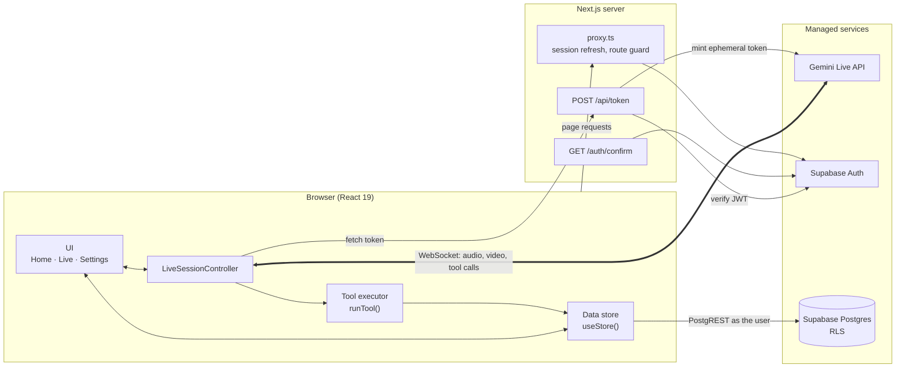
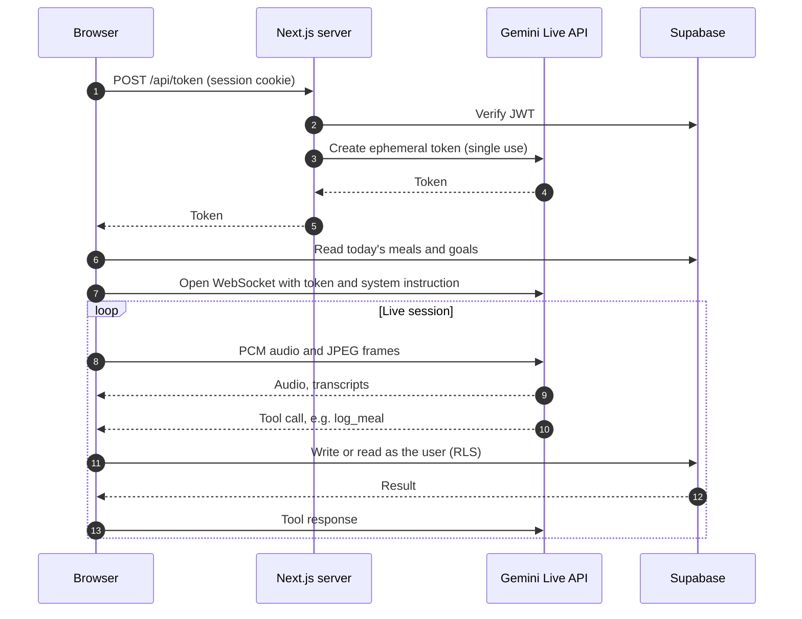

# LensBite 🍽️📷

**Point your camera at food, just talk, and get calories and nutrients back by voice.**

[](https://nextjs.org)
[](https://react.dev)
[](https://www.typescriptlang.org)
[](https://tailwindcss.com)
[](https://ai.google.dev/gemini-api/docs/live)
[](https://supabase.com)
[](#license)

LensBite is a personal AI food tracker in the style of Gemini Live. Open it on your phone, tap **Go Live**, point the rear camera at your plate and ask:

> "What's this and how many calories?"

The agent sees the camera, answers out loud in real time, lets you interrupt it, handles follow-up questions, and logs the meal when you say so. Your day's calories, protein, carbs, fat and fiber are tracked against your own goals and synced to your Supabase account.

---

## Table of contents

- [Demo](#demo)
- [Features](#features)
- [Architecture](#architecture)
- [Tech stack](#tech-stack)
- [Agent tools](#agent-tools)
- [Getting started](#getting-started)
- [Deployment](#deployment)
- [Usage](#usage)
- [Project structure](#project-structure)
- [Customizing](#customizing)
- [Limitations & tips](#limitations--tips)
- [Roadmap](#roadmap)
- [Disclaimer](#disclaimer)
- [License](#license)

---

## Demo

<!--
  Drop images into docs/screenshots/ and replace the placeholders below, e.g.
  
-->

| Home | Live | Label scan |
| :---: | :---: | :---: |
| _Screenshot coming soon_<br>`docs/screenshots/home.png` | _GIF coming soon_<br>`docs/screenshots/live.gif` | _Screenshot coming soon_<br>`docs/screenshots/label-scan.png` |
| Today's totals vs. goals and the meal list | Camera, live transcript, barge-in | Product card with a 0–10 score |

---

## Features

### 🎙️ Live voice + camera food analysis
- Streams your mic (16 kHz PCM) and rear camera (about 1 JPEG frame per second) to Gemini Live over a WebSocket.
- The AI's voice plays immediately and **stops the moment you talk over it** (barge-in).
- Ask follow-ups naturally: "what if I skip the rice?", "how much protein is that?".
- Estimates are given as **ranges** ("roughly 450 to 550 calories"). There's no nutrition database; the model uses its own knowledge, and asks about portion size or hidden oils and sauces when they'd change the answer a lot.
- A live transcript of both sides is shown on screen.

### 🏷️ Packaged food label scanning + 0–10 rating
- Show the back of a pack and say **"rate this"**. **Label mode** switches the camera to sharper frames (up to 1536 px, JPEG quality 0.9) so small print stays legible.
- Label mode turns on from what you say, from the agent's `scan_label` call, or from the **Label** button. It switches itself off after 60 s without label activity, unless you turned it on with the button.
- The agent reads the nutrition table and ingredients **exactly as printed**, and asks you to move closer, hold steady or rotate the pack when text is unreadable.
- It scores the product 0–10. It weighs sugar, sodium, saturated and trans fat against protein and fiber, plus ingredient quality (added sugars under any name, refined flour, palm oil, sweeteners, colors, ultra-processing), misleading claims, unrealistic serving sizes, and what's left of your goals today.
- A **product card** shows the color-coded score, key numbers per 100 g/ml and per serving (UK FSA–style traffic-light colors), pros, cons and ingredient warnings. If the label prints only one column, the app computes the other from the serving size, and it derives salt from sodium or the other way round.
- Say **"log one serving"** (or two) to log it with the exact label values. Nothing about a scanned product is stored unless you log it.

### 📊 Daily tracking against goals
- Calories, protein, carbs, fat and fiber for today, shown as a calorie ring and macro bars against your daily goals.
- Today's meal list with type, time, macros and notes. Tap 🗑 to delete a meal.
- "Today" follows your phone's local timezone and rolls over at midnight.

### 🗣️ Voice logging and daily summary
- The agent always asks before logging, using single best-estimate numbers ("Want me to log that as about 500 calories?"), and picks the meal type from the time of day unless you say otherwise.
- Ask "how am I doing today?" for totals and what's left, or "undo that" to remove the last meal.
- The system prompt is rebuilt on every (re)connect with your latest goals and today's meals.

### 🔐 Supabase sync, magic-link login, Row Level Security
- Sign in with an email magic link. Every page needs a session, and signed-out visitors go to `/login`.
- Meals and goals live in Supabase Postgres. **Row Level Security** limits every read and write to `user_id = auth.uid()`, even for someone calling the Supabase API directly with the public key.
- `GEMINI_API_KEY` never leaves the server. Signed-in users get a single-use, short-lived **ephemeral token** from `/api/token`.

### ⚙️ Settings and data
- Edit or reset daily goals for calories, protein, carbs, fat and fiber.
- **Export / import JSON** backups. Imports merge by meal id, so meals already in your account are skipped.
- **Move old local data:** if this browser still holds meals from the earlier localStorage-only version, one tap moves them into your account.
- Clear all data, and sign out.

### 🛟 Reliability and quality-of-life details
- Auto-ends after **2 minutes of silence** to save quota, with a countdown for the last 20 s.
- Context-window compression keeps audio + video sessions going past the API's ~2-minute default.
- Transparent **reconnect with session resumption** when the server rotates the connection (about every 10 minutes) or the network blips, up to 3 attempts.
- If the camera fails, the session continues voice-only. Denied or missing devices, non-HTTPS origins and quota errors get friendly messages.
- Keeps the screen awake while live (Wake Lock API, where supported).

---

## Architecture

### Overview

LensBite is a client-heavy Next.js application. The real-time media pipeline runs entirely in the browser, which holds a direct WebSocket to the Gemini Live API so audio round-trips skip the application server. The server has three narrow responsibilities: maintaining the Supabase session, completing the magic-link sign-in, and exchanging a verified session for a short-lived Gemini credential. Persistent state lives in Supabase Postgres, where Row Level Security is the authorization boundary.



### Components

| Layer | Component | Responsibility |
| --- | --- | --- |
| Client | `LiveSessionController` (`src/lib/live-session.ts`) | Owns the live session lifecycle: device capture, streaming, playback, transcripts, tool dispatch, label mode, silence timeout and reconnection. A framework-agnostic class exposed to React through `useSyncExternalStore`. |
| Client | `MicStreamer` / `PcmPlayer` (`src/lib/audio.ts`) | Captures the microphone through an AudioWorklet as 16 kHz 16-bit PCM; plays 24 kHz model audio gap-free and can stop it instantly. |
| Client | `FrameGrabber` (`src/lib/media.ts`) | Samples the rear camera to JPEG at 1 fps, at standard or label-mode resolution. |
| Client | Tool executor (`src/lib/tools.ts`) | Declares the agent's functions and executes model tool calls; never rejects, so the model always receives a response. |
| Client | Data store (`src/lib/storage.ts`) | Single source of truth for today's meals, goals and meal count, shared by the UI and the tools. |
| Server | Proxy (`src/proxy.ts`) | Runs before every page and API request: refreshes Supabase auth cookies and redirects unauthenticated page requests to `/login`. |
| Server | `POST /api/token` | Verifies the caller's JWT, then issues a single-use Gemini ephemeral token. The only code path that reads `GEMINI_API_KEY`. |
| Server | `GET /auth/confirm` | Completes magic-link sign-in (PKCE code exchange or `token_hash` verification) and sets the session cookie. |
| External | Gemini Live API | Speech recognition, multimodal reasoning, speech synthesis and function calling over one bidirectional stream. |
| External | Supabase | Email magic-link authentication and the Postgres database. |

### Request flows

**1. Authentication.** The user requests a magic link from `/login`. The emailed link lands on `/auth/confirm`, which exchanges it for a session stored in HTTP cookies. On every subsequent request the proxy validates the session with `getClaims()`, refreshing tokens when needed, and sends signed-out visitors back to `/login`. API routes are exempt from the redirect and return `401` themselves.

**2. Session start.** Tapping **Go Live** acquires the microphone and camera inside the user gesture (required for audio on iOS), then fetches an ephemeral token and the latest snapshot of today's log in parallel. The snapshot is rendered into the system instruction, so the agent starts with current goals and totals, and the client opens the Live WebSocket with the token.

**3. Real-time loop.** Microphone audio streams continuously and camera frames at 1 fps. Model audio is queued for playback, and an `interrupted` signal from the server clears the queue immediately (barge-in). Input and output transcriptions drive the on-screen transcript.

**4. Tool execution.** When the model emits a tool call, the browser executes it against Supabase with the user's own session, so Row Level Security applies exactly as it would to any direct API call. The result is returned with `sendToolResponse`. Tools are declared `BLOCKING`, so the model waits for the persisted result before confirming to the user.



### Data model

| Table | Key | Columns | Notes |
| --- | --- | --- | --- |
| `meals` | `id` (uuid) | `user_id`, `eaten_at`, `meal_type`, `name`, `calories`, `protein_g`, `carbs_g`, `fat_g`, `fiber_g`, `notes` | Indexed on `(user_id, eaten_at desc)`. Check constraints enforce valid meal types, non-negative nutrients and length limits. |
| `settings` | `user_id` | `calorie_goal`, `protein_goal`, `carbs_goal`, `fat_goal`, `fiber_goal` | One row per user; a missing row means default goals. Written with upsert. |

`user_id` defaults to `auth.uid()` and references `auth.users` with `on delete cascade`, so clients never supply it and deleting a user removes their data. "Today" is computed from the device's local timezone and queried as an `eaten_at` range, so the day boundary follows the user, not the server.

### State management

The client store caches only the current day's meals, the goals and a total meal count. Every mutation writes to Supabase first and then re-reads, so the cache always reflects the database rather than an optimistic guess. A sequence counter ensures that an older read finishing late cannot overwrite a newer one. The store also reloads when the app returns to the foreground and when the local date rolls over at midnight.

### Security model

- **Secret isolation.** `GEMINI_API_KEY` is read only by `/api/token` and never reaches the client. The browser receives a token valid for one session, which must start within 60 seconds and expires after 30 minutes.
- **Authenticated token issuance.** Tokens are issued only after server-side JWT verification, so an exposed deployment URL cannot be used to spend the API quota.
- **Database-enforced authorization.** Each table has Row Level Security with one policy per operation (`select`, `insert`, `update`, `delete`), all scoped to `user_id = auth.uid()`. The Supabase URL and publishable key are public by design; RLS, not the proxy, is the enforcement boundary.
- **Session hygiene.** Responses that set auth cookies carry `no-store` cache headers so a CDN cannot serve one user's session to another. Post-login redirects accept same-site paths only. Signing out performs a full page load to clear all in-memory user data.

### Resilience

- **Session rotation.** Gemini Live connections are rotated by the server roughly every 10 minutes. The client keeps the latest session-resumption handle, reconnects on `goAway` or an unexpected close, and resumes the conversation (up to 3 attempts with backoff).
- **Long sessions.** Context-window compression is enabled, so audio and video sessions are not capped at the API's default duration.
- **Stale events.** A generation counter, incremented on every connect and teardown, discards callbacks and tool results that belong to a superseded connection.
- **Graceful degradation.** If the camera is unavailable the session continues voice-only; device, permission, HTTPS and quota failures surface as specific user-facing messages.
- **Cost control.** Sessions end automatically after 2 minutes without conversation. High-resolution label frames are sent only while label mode is active.

---

## Tech stack

| Layer | Technology | Version |
| --- | --- | --- |
| Framework | [Next.js](https://nextjs.org) (App Router, Turbopack, Cache Components) | 16.4.0 |
| UI | [React](https://react.dev) | 19.3.0 |
| Language | [TypeScript](https://www.typescriptlang.org) | ^5 |
| Styling | [Tailwind CSS](https://tailwindcss.com) | ^4 |
| AI | [`@google/genai`](https://www.npmjs.com/package/@google/genai), Gemini Live API (`gemini-3.8-live`) | ^2.28.0 |
| Auth + database | [`@supabase/ssr`](https://www.npmjs.com/package/@supabase/ssr), [`@supabase/supabase-js`](https://www.npmjs.com/package/@supabase/supabase-js) | ^0.12.7, ^2.117.3 |
| Audio | Web Audio API + an AudioWorklet (`public/worklets/pcm-recorder.js`) | – |
| Hosting | [Vercel](https://vercel.com) (any Node.js host works) | – |

---

## Agent tools

The agent's function-calling tools are declared in `src/lib/tools.ts` and run in the browser. All of them are **blocking**, so the model waits for the real result before it says "logged!".

| Tool | Parameters | What it does |
| --- | --- | --- |
| `log_meal` | `name`, `meal_type` (`breakfast` / `lunch` / `dinner` / `snack`), `calories`, `protein_g`, `carbs_g`, `fat_g`, `fiber_g`, `notes` (optional) | Saves a meal to Supabase. Only called after you confirm. Returns what was logged, today's totals and what's left. |
| `get_today_summary` | – | Reads today's meals from Supabase and returns them with totals, goals and what's left. |
| `delete_last_meal` | – | Deletes the most recent meal from today (undo) and returns the updated totals. |
| `scan_label` | – | Turns on label mode (sharp, high-resolution frames) before the agent reads a pack. |
| `show_product_rating` | `product_name`, `score` (0–10), `verdict`, `unit` (`g` / `ml`), `pros`, `cons`, `ingredient_warnings`; optional `brand`, `serving_size`, `serving_description`, `servings_per_pack`, `per_serving`, `per_100` | Shows the product card on screen (never saved). Returns the nutrition normalized per 100 g/ml and per serving, which the agent then uses for follow-ups and `log_meal`. |

`per_serving` and `per_100` are objects with any of: `calories`, `fat_g`, `saturated_fat_g`, `trans_fat_g`, `carbs_g`, `sugar_g`, `added_sugar_g`, `fiber_g`, `protein_g`, `sodium_mg`, `salt_g`.

---

## Getting started

### Prerequisites

- **Node.js 20+** and npm
- A **Gemini API key** (free tier works): <https://aistudio.google.com/apikey>
- A **Supabase project** (free tier works): <https://supabase.com/dashboard>

### 1. Clone and install

```bash
git clone https://github.com/krushna-sahu1/lensbite.git
cd lensbite
npm install
```

### 2. Create the database tables

The migrations in `supabase/migrations/` create two tables, both with Row Level Security on and one policy per operation (`user_id = auth.uid()`):

| Table | Columns |
| --- | --- |
| `meals` | `id`, `user_id`, `eaten_at`, `meal_type`, `name`, `calories`, `protein_g`, `carbs_g`, `fat_g`, `fiber_g`, `notes` |
| `settings` | `user_id`, `calorie_goal`, `protein_goal`, `carbs_goal`, `fat_goal`, `fiber_goal` |

Apply them in one of two ways:

- **Dashboard:** open **SQL Editor**, then paste and run each file in name order.
- **CLI:**

  ```bash
  npx supabase login
  npx supabase init        # once; keeps the existing supabase/migrations folder
  npx supabase link --project-ref <your-project-ref>
  npx supabase db push
  ```

### 3. Configure sign-in

In the Supabase dashboard, open **Authentication → URL Configuration**:

- **Site URL:** `http://localhost:3000` for now (your production URL later).
- **Redirect URLs:** add `http://localhost:3000/auth/confirm`.

Email magic-link sign-in is on by default.

### 4. Set environment variables

```bash
cp .env.example .env.local
```

| Variable | Required | Where to find it | Notes |
| --- | :---: | --- | --- |
| `GEMINI_API_KEY` | ✅ | [Google AI Studio](https://aistudio.google.com/apikey) | **Server-only.** Never prefix it with `NEXT_PUBLIC_`. |
| `NEXT_PUBLIC_SUPABASE_URL` | ✅ | Supabase → Project Settings → API | e.g. `https://<project-ref>.supabase.co` |
| `NEXT_PUBLIC_SUPABASE_PUBLISHABLE_KEY` | ✅ | Supabase → Project Settings → API Keys | The publishable key (`sb_publishable_…`); the legacy `anon` key works too. Public by design: RLS protects the data. |

### 5. Run it

```bash
npm run dev
```

Open <http://localhost:3000>, enter your email, and open the sign-in link **in the same browser**. `localhost` counts as a secure origin, so camera and mic work on your computer.

| Script | What it does |
| --- | --- |
| `npm run dev` | Start the dev server |
| `npm run build` | Production build |
| `npm run start` | Serve the production build |
| `npm run lint` | Run ESLint |

### 6. Lock it down (recommended)

Once you've signed in the first time, turn off **Authentication → Sign In / Providers → Allow new users to sign up**. Other accounts could never see your data (RLS), but they could spend your Gemini quota.

> **Coming from the localStorage-only version?** Open **Settings** in the browser you used before and tap **Move them to my account**, or import a JSON export.

---

## Deployment

### Vercel

1. Push the repo to GitHub.
2. In Vercel: **Add New → Project** and import the repo (Next.js is detected automatically).
3. Under **Environment Variables**, add `GEMINI_API_KEY`, `NEXT_PUBLIC_SUPABASE_URL` and `NEXT_PUBLIC_SUPABASE_PUBLISHABLE_KEY`.
4. Deploy.

### Supabase auth redirect URLs

In **Authentication → URL Configuration**:

- Set **Site URL** to your production URL, e.g. `https://lensbite.vercel.app`.
- Add `https://<your-domain>/auth/confirm` to **Redirect URLs** (keep the localhost one for development).

### HTTPS is required for camera and mic on phones

Mobile browsers only allow camera and microphone on **HTTPS**, so `http://192.168.x.x:3000` won't work. Your options:

- **Deploy to Vercel** (easiest): every deployment gets an `https://` URL.
- Run `npx next dev --experimental-https` and open `https://<your-computer-ip>:3000` on your phone (accept the self-signed certificate warning).
- Use a tunnel such as `cloudflared tunnel --url http://localhost:3000` or `ngrok http 3000`.

### Signing in on a phone

By default the magic link only works in the **browser that requested it** (Supabase's PKCE flow keeps a secret there). If your mail app opens links in its own browser, sign-in can fail. To make links work in any browser, edit **Authentication → Emails → Magic Link** and point the link straight at the app:

```html
<a href="{{ .SiteURL }}/auth/confirm?token_hash={{ .TokenHash }}&type=email">Sign in to LensBite</a>
```

On iPhone, a home-screen web app keeps its own cookies, separate from Safari's, and email links open in Safari. So use LensBite in Safari (or bookmark it there) rather than adding it to the home screen. On Android, *Add to Home Screen* works well.

---

## Usage

Tap **Go Live**, allow camera and mic, and talk normally. You can interrupt the agent at any time.

| You say | What happens |
| --- | --- |
| "What's this and how many calories?" | Describes what it sees and gives calorie and macro ranges. It may ask one question about portion or hidden extras first. |
| "Log it as lunch" / "Yes, log it" | Confirms the numbers, logs the meal, and tells you roughly how many calories are left today. |
| "Actually it was a small portion, make it 400" | Uses your correction when logging. |
| "Rate this product" / "Check the label" | Turns on label mode, reads the pack, speaks the score with a one- or two-sentence reason, and shows the product card. |
| "How much sugar per serving?" / "What's bad in the ingredients?" | Answers follow-ups from the label it read. |
| "Log one serving" / "Log two servings" | Logs the scanned product with the exact per-serving label values. |
| "How am I doing today?" / "What have I eaten?" | Reads today's meals, totals and what's left from Supabase. |
| "Undo that" / "Delete the last meal" | Removes the most recent meal from today. |

Tap **Label** to force label mode on (it stays on until you tap again), ✕ on the product card to close it, and the top-right ✕ to end the session.

---

## Project structure

```text
lensbite/
├── public/
│   └── worklets/
│       └── pcm-recorder.js        # AudioWorklet: downsamples the mic to 16 kHz 16-bit PCM
├── src/
│   ├── app/
│   │   ├── api/token/route.ts     # POST: ephemeral Gemini token, signed-in users only
│   │   ├── auth/confirm/route.ts  # Magic-link landing: turns the link into a session
│   │   ├── login/page.tsx         # Email magic-link form
│   │   ├── settings/page.tsx      # Goals, export/import, move old local data, sign out
│   │   ├── page.tsx               # Home: daily summary, meal list, Go Live button
│   │   ├── layout.tsx             # Root layout, fonts, viewport/theme color
│   │   └── globals.css            # Tailwind and color tokens
│   ├── components/
│   │   ├── DailySummary.tsx       # Calorie ring + macro bars vs. goals
│   │   ├── LiveView.tsx           # Full-screen camera, transcript and controls
│   │   ├── MealList.tsx           # Today's meals with delete
│   │   ├── ProductCard.tsx        # Label-scan rating card
│   │   └── icons.tsx              # Inline SVG icons
│   ├── lib/
│   │   ├── live-session.ts        # LiveSessionController: the Gemini Live core
│   │   ├── use-live-session.ts    # React binding for the controller
│   │   ├── audio.ts               # MicStreamer (mic → PCM) and PcmPlayer (gap-free playback)
│   │   ├── media.ts               # Camera/mic permissions, error messages, JPEG frame capture
│   │   ├── tools.ts               # Agent tool declarations + browser-side handlers
│   │   ├── prompt.ts              # System instruction: personality, rules, today's context
│   │   ├── label.ts               # Label parsing, per-100 g/serving math, traffic lights
│   │   ├── storage.ts             # Supabase-backed store + useStore() hook
│   │   ├── nutrition.ts           # Totals, remaining, rounding, local-day helpers
│   │   ├── config.ts              # Model, voice, timeouts, frame sizes
│   │   ├── types.ts               # Shared types (Meal, Goals, ProductRating, …)
│   │   ├── use-now.ts             # Current time, refreshed every minute
│   │   └── supabase/
│   │       ├── client.ts          # Browser Supabase client
│   │       ├── server.ts          # Route Handler Supabase client (cookies)
│   │       ├── proxy.ts           # Session refresh + /login redirect logic
│   │       ├── env.ts             # Reads and checks the Supabase env vars
│   │       └── database.types.ts  # Table types matching the migrations
│   └── proxy.ts                   # Next.js proxy (formerly middleware) entry point
├── supabase/
│   └── migrations/                # SQL for the meals and settings tables + RLS policies
├── .env.example                   # Environment variable template
└── next.config.ts                 # Next.js config (Cache Components, Tailwind via Turbopack)
```

---

## Customizing

All the knobs live in `src/lib/config.ts`:

| Setting | Default | What it controls |
| --- | --- | --- |
| `LIVE_MODEL` | `gemini-3.8-live` | Live model. `gemini-3.8-live-extended-thinking` reasons more (it requires non-blocking tools). |
| `VOICE_NAME` | `Kore` | Prebuilt voice, e.g. `Puck`, `Charon`, `Aoede`. |
| `SILENCE_TIMEOUT_MS` | 2 min | Auto-end after this much silence. |
| `FRAME_INTERVAL_MS`, `FRAME_MAX_SIZE`, `FRAME_JPEG_QUALITY` | 1000 ms, 768 px, 0.6 | Normal camera frames. |
| `LABEL_FRAME_MAX_SIZE`, `LABEL_FRAME_JPEG_QUALITY`, `LABEL_MODE_TIMEOUT_MS` | 1536 px, 0.9, 60 s | Label mode. |
| `LIVE_MEDIA_RESOLUTION` | `MEDIA_RESOLUTION_HIGH` | Tokens per frame (~280). Needed to read label print, but uses ~4× the video tokens. Set `MEDIA_RESOLUTION_UNSPECIFIED` if you never scan labels. |

The agent's personality and rules are plain text in `src/lib/prompt.ts`. After changing a table, update `src/lib/supabase/database.types.ts` or regenerate it with `npx supabase gen types typescript --project-id <ref>`.

---

## Limitations & tips

**Accuracy**
- AI estimates are approximate. Portion sizes are hard to judge from a photo, so numbers can easily be **20–40% off**, more with hidden oil, butter or sauces. Tell the agent what you know ("about 200 g", "cooked in olive oil").
- Label scores are the AI's judgment, and a misread digit is possible. Glance at the card's numbers before logging.

**Quotas and limits**
- The Gemini **free tier has rate and usage limits**. If you see "quota exceeded", wait or check usage in Google AI Studio. Sessions auto-end after 2 minutes of silence to save quota, and label mode's high-resolution frames use noticeably more tokens.
- Live connections are rotated by the server about every 10 minutes. LensBite reconnects and resumes automatically, but a weak network can still end a session.
- **Supabase free projects pause after a period of inactivity** (about a week). If the app suddenly can't load your log, restore the project from the Supabase dashboard.
- Supabase's built-in email sender allows only a few emails per hour, which is fine for one person. Add your own SMTP server under **Authentication → Emails** if you hit the limit.

**Getting good results**
- **Good lighting and a steady camera** make a big difference. Hold still for a second or two.
- For labels, fill most of the screen with the nutrition table, avoid glare from overhead lights, and rotate curved packs slowly.
- If the AI keeps interrupting itself, your phone's speaker is leaking into the mic. Lower the volume or use earbuds.
- **"Permission … denied":** allow camera and mic for the site in your browser settings (iOS: *Settings → Safari → Camera / Microphone*), then tap **Go Live** again.
- **No sound on iPhone:** make sure the silent switch is off and the volume is up.
- Ephemeral tokens are a Preview feature of the Gemini API. If token creation starts failing after an SDK upgrade, check the [ephemeral tokens docs](https://ai.google.dev/gemini-api/docs/ephemeral-tokens).

---

## Roadmap

Ideas for what's next. None of these exist yet.

- [ ] **Fridge mode:** show what's in your fridge and get dish suggestions that fit your remaining calories
- [ ] **Water tracking:** log glasses by voice and track them against a daily goal
- [ ] **Weekly recap:** trends and averages across the week
- [ ] **Menu mode:** point at a restaurant menu and get the options that fit your goals
- [ ] **Agent personalities:** pick the coach's tone and voice

---

## Disclaimer

LensBite gives **rough, AI-generated estimates for general information only. It is not medical, nutritional or dietary advice.** Don't rely on it for medical decisions, allergies or managing a health condition. If you have allergies, a medical condition, or concerns about eating, talk to a doctor or a registered dietitian.

---

## License

Released under the [MIT License](https://opensource.org/licenses/MIT).
